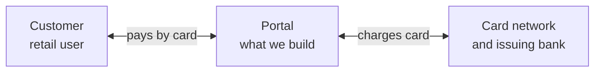
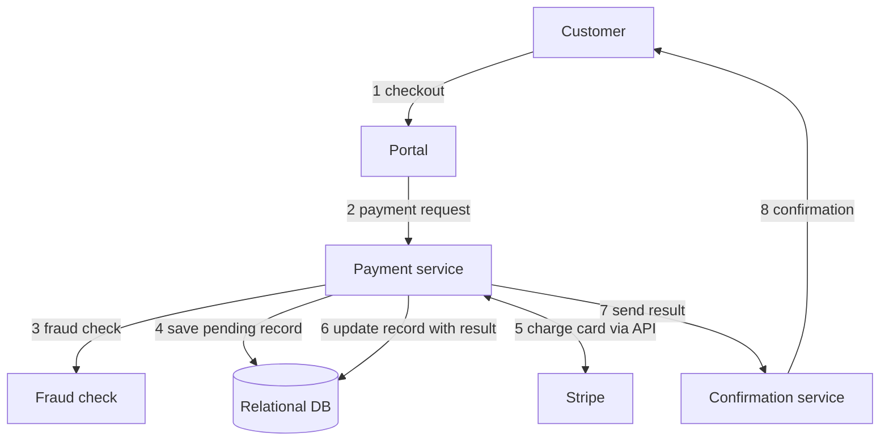

# System Design - Payment Portal

Retail customers pay by credit card; the portal checks for fraud, charges the card through Stripe, and records every transaction.

## Clarifications

- Who are the users - retail end customers
- How many transactions - 100,000 per day at launch, 1 million per day within 3 years
- Which currency - USD only
- Which payment methods - credit cards only (MVP)
- Which geographies - US only
- Card-security rules (PCI) - we comply, and we do not store raw card numbers
- Fraud checks - required before every charge
- How long do we keep records - 7 years

## Functional Requirements

- Ability to pay with a credit card
- Ability to run a fraud check before charging
- Ability to record every transaction
- Ability to charge the card through the card network and return success or failure
- Ability to look up the status of a payment
- Ability to view transaction history

## Non-Functional Requirements

- Consistency over availability - if unsure, decline the payment instead of risking a wrong charge
- No double charge - a retried request never charges twice
- Durability - no transaction is lost, for 7 years
- Availability should be 99.9%
- Latency - a payment completes in under 3 seconds at p99
- Scalability - 100,000 transactions per day at launch, growing to 1 million
- Security - encrypted in transit and at rest, PCI compliant, no raw card numbers stored

## System Context

## High Level Design

## Detailed Design

### Payment service (called by the portal)

- POST /v1/payments
- GET /v1/payments/{payment_id}
- GET /v1/payments?customer_id=...

### Fraud check (internal)

- POST /v1/fraud-checks

### Confirmation service (internal)

- POST /v1/confirmations

### Stripe (outside system, their API)

- POST https://api.stripe.com/v1/payment_intents

## Database Planning

- One SQL database, with a primary and 2 replicas
- customers - customer id, name, email, created at
- payments - payment id, customer id, amount, currency, status (pending, succeeded, failed), Stripe reference, created at, updated at
- No card numbers are stored

## Data Storage Estimation

- Cheat sheet: 10^3 = KB, 10^6 = MB, 10^9 = GB, 10^12 = TB; 1 day = 10^5 seconds
- 1 million payments per day for all 7 years (safe upper bound)
- About 300 bytes per row, 50% extra for indexes, 3 copies

**Calculations**

- Per day = 10^6 * 300 B = 3 * 10^8 B = 300 MB
- 7 years = 7 * 365 = about 2,500 days
- Rows = 10^6 * 2,500 = 2.5 * 10^9 = 2.5 billion
- Total = 3 * 10^8 * 2.5 * 10^3 = 7.5 * 10^11 B = about 0.75 TB
- With indexes (* 1.5) = about 1.1 TB
- With 3 copies = about 3.4 TB
- Customers table = 7 * 10^6 * 200 B = about 1.4 GB (negligible)

## QPS Estimation

- QPS = payments per day / 10^5 seconds
- Peak is 3 times the average
- Per payment: 2 database writes, about 3 database reads, 1 Stripe call, 1 fraud check

| Metric | MVP (10^5 per day) | Target (10^6 per day) |
|---|---|---|
| Payments per second, average | 1 | 10 |
| Payments per second, peak | 3 | 30 |
| DB writes per second, peak | 6 | 60 |
| DB reads per second, peak | 9 | 90 |
| Stripe calls per second, peak | 3 | 30 |
| Fraud checks per second, peak | 3 | 30 |
| Requests in flight at peak (peak * 3 s) | about 9 | about 90 |
